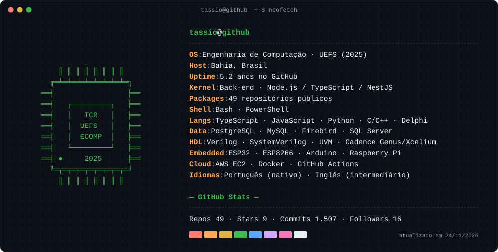
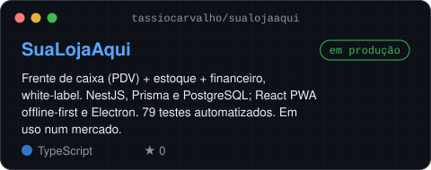
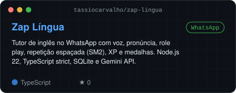
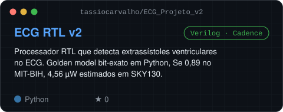
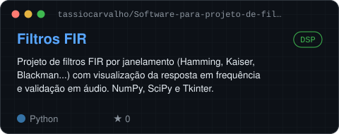

  

  
  
  

  Escrevo <b>back-end</b> em Node.js/TypeScript, desenho <b>hardware digital</b> em Verilog e faço <b>firmware</b> para ESP32. 
  Gosto de entender a pilha inteira: da porta lógica até a API que o cliente usa.

  

## 🚀 Projetos em destaque

  
  
  
  

## 🛠️ Stack

   
   
  

  
  
  
  

## 📡 Agora

- 🛒 **SuaLojaAqui** em produção num mercado: eu desenvolvo e dou o suporte aos usuários.
- 🤖 Bot de WhatsApp rodando 24/7 numa VM Linux na **AWS EC2**, atendendo 3 grupos.
- 🎓 Estudando verificação com **UVM** e cobertura funcional.

<b>🔬 Por baixo do capô (trajetória)</b>

 

| Quando | Onde | O quê |
|---|---|---|
| 2025 | Residência em CI Digital | RTL em Verilog, síntese no Cadence Genus, baixo consumo com clock gating |
| 2024–2025 | UEFS (iniciação científica) | VANT com peças impressas em 3D, firmware ESP8266/ESP32 |
| 2019–2025 | UEFS | Bacharelado em Engenharia de Computação |
| 2016–2019 | K Doce Bom | Suporte técnico, redes, Windows/Linux, CFTV |

  <picture>
    <source media="(prefers-color-scheme: dark)" srcset="https://raw.githubusercontent.com/tassiocarvalho/tassiocarvalho/output/github-snake-dark.svg"/>
    
  </picture>

Os cartões se atualizam sozinhos todo dia via GitHub Actions · <code>scripts/build.py</code>

